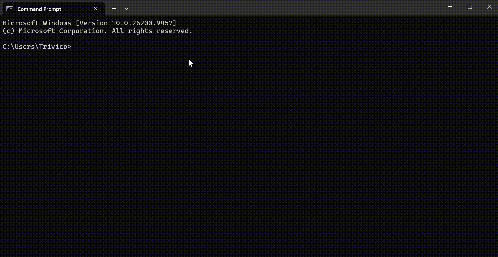

<p align="center">
  
</p>

<h1 align="center">ntc 2.4.8</h1>

<p align="center">
  <b>Navigate · Toolkit · Center</b><br>
  ເຄື່ອງມືທີ່ເປັນປະໂຫຍດໃນເທີມິນອນຂອງທ່ານ ກັບ NTC
</p>

<p align="center">
  Windows · Linux · macOS · Android (ຜ່ານ Termux)
</p>

<p align="center">
  <a href="README.md">English</a> ·
  <a href="README.th.md">ไทย</a> ·
  <b>ລາວ</b> ·
  <a href="README.zh.md">中文</a>
</p>

---

<p align="center">
  
</p>

---

## ntc ແມ່ນຫຍັງ?

ເຄື່ອງມື CLI ຫຼາຍຢ່າງລວມຢູ່ໃນ CLI ດຽວ ພ້ອມຄຳສັ່ງນຳທາງທີ່ໃຊ້ງ່າຍ

| ຄຳສັ່ງ | ໜ້າທີ່ |
| ------- | ------- |
| `tp` | ຈຸດບັນທຶກເທເລພອດ (ວາບ) |
| `ral` | ອາລິອາດທີ່ມີພາຣາມິເຕີ |
| `ran` | ຕົວຮັນງານ |
| `nfe` | ຕົວສຳຫຼວດໄຟລ໌ |
| `ne` | ໂປຣແກຣມແກ້ໄຂໃນຕົວ |
| `sys` | ຕົວກວດກາລະບົບ |
| `spec` | ສະເປັກລະບົບ ແລະ ການໃຊ້ດິສ |
| `gosc` | ການນຳທາງຕໍ່ເນື່ອງ |
| `fake` | ຕົວສ້າງຂໍ້ມູນຈຳລອງ |
| `serve files` | ໃຫ້ບໍລິການໄດຣຟ໌ຂອງທ່ານຜ່ານອຸປະກອນ |

…ແລະ ອື່ນໆ

ພິມ `help` ເພື່ອເບິ່ງຂໍ້ມູນເພີ່ມເຕີມ

ພິມ `tutorial` ເພື່ອທົດລອງໃນແຊນບັອກຂອງ ntc

---

## ມີຫຍັງໃໝ່

- `spec` ສະແດງແຕ່ລະດິສເປັນ `ໃຊ້ແລ້ວ/ທັງໝົດ ເປີເຊັນ ພື້ນທີ່ຫວ່າງ` ເຊັ່ນ
  `200 GB/300 GB 67% 100 GB ຫວ່າງ` — ຄຳວ່າ "ຫວ່າງ" ຈະປ່ຽນຕາມພາສາທີ່ໃຊ້
- `spec` ສະແດງກາດຈໍໜຶ່ງແຖວຕໍ່ໜຶ່ງຕົວ ແລະ ຈະໃຊ້ຊື່ຊິບ Android ແທນ
  ເມື່ອລະບົບບໍ່ສະແດງຊື່ CPU

---

## ຕິດຕັ້ງ

### npm (ທຸກແພລດຟອມ)

```bash
npm install -g @nuengcoder/ntc
```

### pip (Windows x64 · Linux x64 · macOS x64 · macOS arm64)

```bash
pip install ntc-cli
```

ໝາຍເຫດ: pip wheel ເຜີຍແຜ່ສະເພາະສີ່ແພລດຟອມຂ້າງເທິງເທົ່ານັ້ນ
Android/Termux ແລະ Windows ARM64 ບໍ່ມີໃນ PyPI — ໃຫ້ໃຊ້ npm ຫຼື
ໄຟລ໌ໄບນາຣີຈາກ GitHub Release ແທນ

### ຊ່ອງທາງອື່ນ

- GitHub Releases — ໄຟລ໌ໄບນາຣີສຳເລັດຮູບສຳລັບທຸກແພລດຟອມທີ່ຮອງຮັບ:
  https://github.com/NuengCoder/ntc/releases
- ຕົວຕິດຕັ້ງ Windows — ເບິ່ງຕາຕະລາງຂ້າງລຸ່ມ

---

## ແພລດຟອມທີ່ຮອງຮັບ

| ແພລດຟອມ | npm | pip | GitHub Release | ໝາຍເຫດ |
| -------- | :-: | :-: | :------------: | -------- |
| Windows 10/11 x64 | yes | yes | yes | wheel `win_amd64` |
| Windows 10/11 ARM64 | yes | no | yes | ຍັງບໍ່ມີ pip wheel |
| Windows 7 x64 | yes | no | yes | ໃຊ້ຕົວຕິດຕັ້ງ / npm |
| Windows 7 ARM64 | yes | no | yes | ຕົວຕິດຕັ້ງ / npm ເທົ່ານັ້ນ |
| Linux x64 (glibc) | yes | yes | yes | wheel `manylinux_2_28` |
| Linux ARM64 (glibc) | yes | no | yes | ຍັງບໍ່ມີ pip wheel |
| macOS x64 | yes | yes | yes | `macosx_*_x86_64` |
| macOS ARM64 | yes | yes | yes | `macosx_*_arm64` |
| Android / Termux | yes | no | yes | ໃຊ້ asset ຂອງ Termux ຜ່ານ npm |

ຄຳອະທິບາຍ: yes = ຮອງຮັບ · no = ບໍ່ມີໃຫ້ໃຊ້

---

## ການໃຊ້ງານ

```bash
ntc
```

---

<p align="center">
  <a href="README.md">English</a> ·
  <a href="README.th.md">ไทย</a> ·
  <b>ລາວ</b> ·
  <a href="README.zh.md">中文</a>
</p>

<p align="center">
  <a href="https://github.com/NuengCoder/ntc">GitHub</a> ·
  <a href="https://github.com/NuengCoder/ntc/releases">Releases</a> ·
  <a href="CHANGELOG.md">Changelog</a>
</p>
