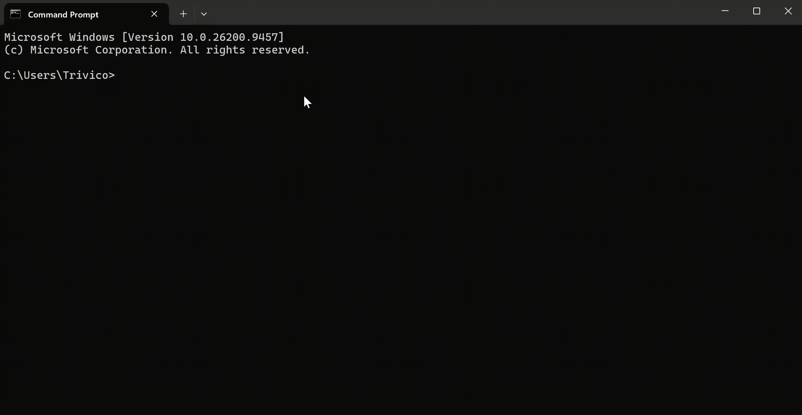

<p align="center">
  
</p>

<h1 align="center">ntc 2.4.8</h1>

<p align="center">
  <b>Navigate · Toolkit · Center</b><br>
  Useful tools in your terminal, with NTC.
</p>

<p align="center">
  Windows · Linux · macOS · Android (via Termux)
</p>

<p align="center">
  <b>English</b> ·
  <a href="README.th.md">ไทย</a> ·
  <a href="README.lo.md">ລາວ</a> ·
  <a href="README.zh.md">中文</a>
</p>

---

<p align="center">
  
</p>

---

## What is ntc?

A multi CLI tool gathered in one CLI tool, with nice navigation commands.

| Command | What it does |
| ------- | ------------ |
| `tp` | Teleport savepoints |
| `ral` | Parameterized aliases |
| `ran` | Task runner |
| `nfe` | File explorer |
| `ne` | Built-in editor |
| `sys` | System monitor |
| `spec` | System specifications and disk usage |
| `gosc` | Continuous navigation |
| `fake` | Fake data generator |
| `serve files` | Serve your own drive through your device |

…and more.

`help` for more info.

`tutorial` for testing the ntc sandbox.

---

## What's new

- `spec` now shows each disk as `used/total percentage free`, for example
  `200 GB/300 GB 67% 100 GB free` — the `free` label follows your language.
- `spec` lists one row per GPU and falls back to the Android SoC name when the
  CPU brand is not exposed by the system.

---

## Install

### npm (all platforms)

```bash
npm install -g @nuengcoder/ntc
```

### pip (Windows x64 · Linux x64 · macOS x64 · macOS arm64)

```bash
pip install ntc-cli
```

Note: pip wheels are only published for the four platforms above.
Android/Termux and Windows ARM64 are not on PyPI — use npm or the
GitHub Release binaries for those.

### Other channels

- GitHub Releases — prebuilt binaries for every supported platform:
  https://github.com/NuengCoder/ntc/releases
- Windows installer — see the table below.

---

## Platform support

| Platform | npm | pip | GitHub Release | Notes |
| -------- | :-: | :-: | :------------: | ----- |
| Windows 10/11 x64 | yes | yes | yes | `win_amd64` wheel |
| Windows 10/11 ARM64 | yes | no | yes | pip wheel not published yet |
| Windows 7 x64 | yes | no | yes | use installer / npm |
| Windows 7 ARM64 | yes | no | yes | installer / npm only |
| Linux x64 (glibc) | yes | yes | yes | `manylinux_2_28` wheel |
| Linux ARM64 (glibc) | yes | no | yes | pip wheel not published yet |
| macOS x64 | yes | yes | yes | `macosx_*_x86_64` |
| macOS ARM64 | yes | yes | yes | `macosx_*_arm64` |
| Android / Termux | yes | no | yes | Termux asset via npm fallback |

Legend: yes = supported · no = not available

---

## Use

```bash
ntc
```

---

<p align="center">
  <a href="README.th.md">ไทย</a> ·
  <a href="README.lo.md">ລາວ</a> ·
  <a href="README.zh.md">中文</a>
</p>

<p align="center">
  <a href="https://github.com/NuengCoder/ntc">GitHub</a> ·
  <a href="https://github.com/NuengCoder/ntc/releases">Releases</a> ·
  <a href="CHANGELOG.md">Changelog</a>
</p>
