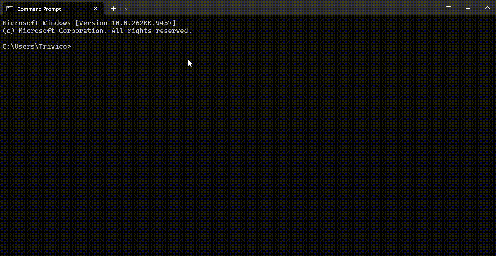

<p align="center">
  
</p>

<h1 align="center">ntc 2.4.6</h1>

<p align="center">
  <b>Navigate · Toolkit · Center</b><br>
  Useful tools in your terminal, with NTC.
</p>

<p align="center">
  Windows only for now.
</p>

---

<p align="center">
  
</p>

---

## What is ntc?

a multi cli tool gathered in one cli tool with nice navigation command.

| Command | What it does |
| ------- | ------------ |
| `tp` | Teleport savepoints |
| `ral` | Parameterized aliases |
| `ran` | Task runner |
| `nfe` | File explorer |
| `ne` | Built-in editor |
| `sys` | System monitor |
| `gosc` | Continuous navigation |

and other ...

`help` | for more info

---

## Install

```bash
npm install -g @nuengcoder/ntc
```

Or download from [GitHub Releases](https://github.com/NuengCoder/ntc/releases).

## Use

```bash
ntc
```

---

<p align="center">
  <a href="https://github.com/NuengCoder/ntc">GitHub</a> ·
  <a href="https://github.com/NuengCoder/ntc/releases">Releases</a> ·
  <a href="CHANGELOG.md">Changelog</a>
</p>
