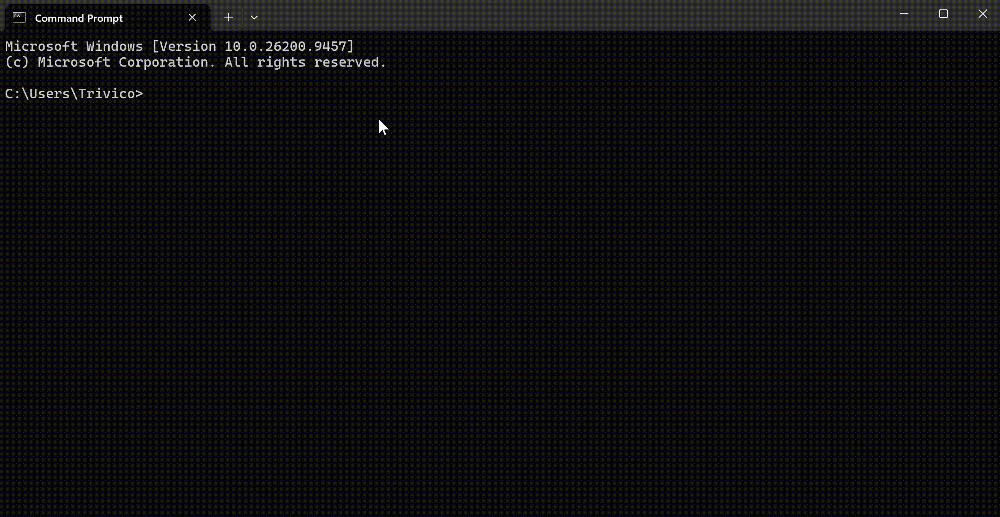

<p align="center">
  
</p>

<h1 align="center">ntc 2.4.8</h1>

<p align="center">
  <b>Navigate · Toolkit · Center</b><br>
  เครื่องมือที่มีประโยชน์ในเทอร์มินัลของคุณ ด้วย NTC
</p>

<p align="center">
  Windows · Linux · macOS · Android (ผ่าน Termux)
</p>

<p align="center">
  <a href="README.md">English</a> ·
  <b>ไทย</b> ·
  <a href="README.lo.md">ລາວ</a> ·
  <a href="README.zh.md">中文</a>
</p>

---

<p align="center">
  
</p>

---

## ntc คืออะไร?

เครื่องมือ CLI หลากหลายรวมไว้ใน CLI เดียว พร้อมคำสั่งนำทางที่ใช้งานง่าย

| คำสั่ง | สิ่งที่ทำ |
| ------ | --------- |
| `tp` | จุดบันทึกเทเลพอร์ต (วาร์ป) |
| `ral` | อะลิอัสแบบมีพารามิเตอร์ |
| `ran` | ตัวรันงาน |
| `nfe` | ตัวสำรวจไฟล์ |
| `ne` | โปรแกรมแก้ไขในตัว |
| `sys` | ตัวตรวจสอบระบบ |
| `spec` | สเปกระบบและการใช้พื้นที่ดิสก์ |
| `gosc` | การนำทางต่อเนื่อง |
| `fake` | ตัวสร้างข้อมูลจำลอง |
| `serve files` | ให้บริการไดรฟ์ของคุณผ่านอุปกรณ์ |

…และอื่น ๆ อีกมากมาย

พิมพ์ `help` เพื่อดูข้อมูลเพิ่มเติม

พิมพ์ `tutorial` เพื่อทดลองแซนด์บ็อกซ์ของ ntc

---

## มีอะไรใหม่

- `spec` แสดงแต่ละดิสก์เป็น `ใช้แล้ว/ทั้งหมด เปอร์เซ็นต์ พื้นที่ว่าง` เช่น
  `200 GB/300 GB 67% 100 GB ว่าง` — คำว่า "ว่าง" จะเปลี่ยนตามภาษาที่ใช้
- `spec` แสดงการ์ดจอหนึ่งแถวต่อหนึ่งตัว และจะใช้ชื่อชิป Android แทน
  เมื่อระบบไม่แสดงชื่อ CPU

---

## ติดตั้ง

### npm (ทุกแพลตฟอร์ม)

```bash
npm install -g @nuengcoder/ntc
```

### pip (Windows x64 · Linux x64 · macOS x64 · macOS arm64)

```bash
pip install ntc-cli
```

หมายเหตุ: pip wheel เผยแพร่เฉพาะสี่แพลตฟอร์มข้างต้นเท่านั้น
Android/Termux และ Windows ARM64 ไม่มีบน PyPI — ให้ใช้ npm หรือ
ไฟล์ไบนารีจาก GitHub Release แทน

### ช่องทางอื่น

- GitHub Releases — ไฟล์ไบนารีสำเร็จรูปสำหรับทุกแพลตฟอร์มที่รองรับ:
  https://github.com/NuengCoder/ntc/releases
- ตัวติดตั้ง Windows — ดูตารางด้านล่าง

---

## แพลตฟอร์มที่รองรับ

| แพลตฟอร์ม | npm | pip | GitHub Release | หมายเหตุ |
| --------- | :-: | :-: | :------------: | -------- |
| Windows 10/11 x64 | yes | yes | yes | wheel `win_amd64` |
| Windows 10/11 ARM64 | yes | no | yes | ยังไม่มี pip wheel |
| Windows 7 x64 | yes | no | yes | ใช้ตัวติดตั้ง / npm |
| Windows 7 ARM64 | yes | no | yes | ตัวติดตั้ง / npm เท่านั้น |
| Linux x64 (glibc) | yes | yes | yes | wheel `manylinux_2_28` |
| Linux ARM64 (glibc) | yes | no | yes | ยังไม่มี pip wheel |
| macOS x64 | yes | yes | yes | `macosx_*_x86_64` |
| macOS ARM64 | yes | yes | yes | `macosx_*_arm64` |
| Android / Termux | yes | no | yes | ใช้ asset ของ Termux ผ่าน npm |

คำอธิบาย: yes = รองรับ · no = ไม่มีให้ใช้

---

## การใช้งาน

```bash
ntc
```

---

<p align="center">
  <a href="README.md">English</a> ·
  <b>ไทย</b> ·
  <a href="README.lo.md">ລາວ</a> ·
  <a href="README.zh.md">中文</a>
</p>

<p align="center">
  <a href="https://github.com/NuengCoder/ntc">GitHub</a> ·
  <a href="https://github.com/NuengCoder/ntc/releases">Releases</a> ·
  <a href="CHANGELOG.md">Changelog</a>
</p>
