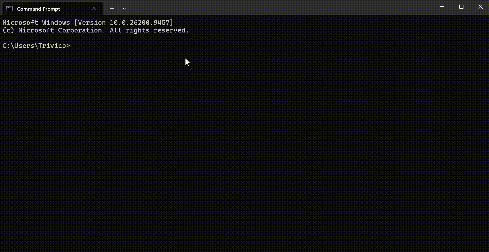

<p align="center">
  
</p>

<h1 align="center">ntc 2.4.8</h1>

<p align="center">
  <b>Navigate · Toolkit · Center</b><br>
  在终端中使用的实用工具，尽在 NTC。
</p>

<p align="center">
  Windows · Linux · macOS · Android（通过 Termux）
</p>

<p align="center">
  <a href="README.md">English</a> ·
  <a href="README.th.md">ไทย</a> ·
  <a href="README.lo.md">ລາວ</a> ·
  <b>中文</b>
</p>

---

<p align="center">
  
</p>

---

## 什么是 ntc？

将多种 CLI 工具集于一身，并配有便捷的导航命令。

| 命令 | 功能 |
| ---- | ---- |
| `tp` | 传送保存点 |
| `ral` | 带参数的别名 |
| `ran` | 任务运行器 |
| `nfe` | 文件浏览器 |
| `ne` | 内置编辑器 |
| `sys` | 系统监视器 |
| `spec` | 系统规格与磁盘使用情况 |
| `gosc` | 连续导航 |
| `fake` | 模拟数据生成器 |
| `serve files` | 通过你的设备共享自己的硬盘 |

……以及更多。

输入 `help` 查看更多信息。

输入 `tutorial` 试用 ntc 沙盒。

---

## 最新变化

- `spec` 现在会将每个磁盘显示为 `已用/总计 百分比 可用空间`，例如
  `200 GB/300 GB 67% 100 GB 可用` —— “可用”标签会跟随当前语言。
- `spec` 会为每块 GPU 单独显示一行；当系统未提供 CPU 品牌时，
  会回退显示 Android SoC 名称。

---

## 安装

### npm（所有平台）

```bash
npm install -g @nuengcoder/ntc
```

### pip（Windows x64 · Linux x64 · macOS x64 · macOS arm64）

```bash
pip install ntc-cli
```

注意：pip wheel 仅为上述四个平台发布。
Android/Termux 和 Windows ARM64 未发布到 PyPI —— 请使用 npm 或
GitHub Release 二进制文件。

### 其他渠道

- GitHub Releases —— 适用于所有支持平台的预编译二进制文件：
  https://github.com/NuengCoder/ntc/releases
- Windows 安装程序 —— 见下表

---

## 平台支持

| 平台 | npm | pip | GitHub Release | 备注 |
| ---- | :-: | :-: | :------------: | ---- |
| Windows 10/11 x64 | yes | yes | yes | `win_amd64` wheel |
| Windows 10/11 ARM64 | yes | no | yes | 尚未发布 pip wheel |
| Windows 7 x64 | yes | no | yes | 使用安装程序 / npm |
| Windows 7 ARM64 | yes | no | yes | 仅安装程序 / npm |
| Linux x64 (glibc) | yes | yes | yes | `manylinux_2_28` wheel |
| Linux ARM64 (glibc) | yes | no | yes | 尚未发布 pip wheel |
| macOS x64 | yes | yes | yes | `macosx_*_x86_64` |
| macOS ARM64 | yes | yes | yes | `macosx_*_arm64` |
| Android / Termux | yes | no | yes | 通过 npm 回退使用 Termux asset |

图例：yes = 支持 · no = 不可用

---

## 使用

```bash
ntc
```

---

<p align="center">
  <a href="README.md">English</a> ·
  <a href="README.th.md">ไทย</a> ·
  <a href="README.lo.md">ລາວ</a> ·
  <b>中文</b>
</p>

<p align="center">
  <a href="https://github.com/NuengCoder/ntc">GitHub</a> ·
  <a href="https://github.com/NuengCoder/ntc/releases">Releases</a> ·
  <a href="CHANGELOG.md">Changelog</a>
</p>
